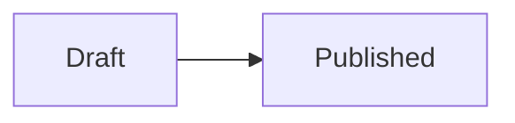

# oxidt-markdown-editor

A Markdown writing field with live formatting, shared by Topcoat and Dioxus.
Headings, emphasis, links, lists, code blocks, images, tables and diagrams render in
place. Syntax stays visible on selected lines and reappears when the cursor
returns to a line; clicking a rendered table moves the cursor into its source.
The underlying value is always Markdown. Table cells show their source text.

Enable only the framework you use. No framework is enabled by default.
Both wrappers bundle the same checked-in JavaScript; consumers do not need Bun.

## Slash commands

Type `/` at the start of an empty line to open the command menu. Keep typing
to filter, use Up/Down and Enter to choose, or click an option. Escape dismisses
the menu and leaves the typed text intact. Commands also stay literal in code
blocks. Inserting a command is one undo step and updates the form value normally.

Commands: `/heading-1`, `/heading-2`, `/heading-3`, `/bullet-list`,
`/numbered-list`, `/task-list`, `/quote`, `/code`, and `/diagram`. The code command
inserts a fenced block with the cursor inside it. The diagram command inserts
an editable Mermaid flowchart.

## Diagrams

Fenced `mermaid` blocks render locally as SVG using [Pele](https://pele.run/):

````markdown

````

Click a diagram or move the cursor into its block to edit the source. Leaving
the block restores the preview. Invalid diagrams show an error and their source;
unclosed fences stay as code. The saved value remains ordinary Markdown.

Diagrams inherit the editor's colors and fit its width. Links and external images
inside diagrams are disabled in previews. Pele is included in the shared bundle;
no CDN or separate setup is needed in either framework.

## Topcoat

```rust,ignore
use oxidt_markdown_editor::topcoat::markdown_editor;
use topcoat::view::{attributes, view};

view! {
    markdown_editor(
        value: &post.markdown,
        attrs: attributes! {
            id="post-body"
            name="markdown"
            aria-label="Post body"
            placeholder="Write in Markdown…"
        },
    )
}
```

Use Topcoat's usual asset bundling and `.assets(AssetBundle::load()?)` setup.
The component renders a module script with a content-hashed asset URL and an
escaped textarea. Without JavaScript, ordinary form submission still works.
The component needs no Topcoat runtime signals, shards, or WebSocket connection.

## Dioxus

```rust,ignore
use oxidt_markdown_editor::dioxus::MarkdownEditor;

rsx! {
    MarkdownEditor {
        id: "message-body",
        value: body(),
        oninput: move |value| body.set(value),
        label: "Message",
        disabled: busy(),
        required: true,
        maxlength: 100_000,
    }
}
```

`document::Script` loads the module once. Controlled value changes, including
a rerender that rejects an edit, update the editor without echoing an input
event. Server rendering puts the first value in the textarea for the no-JS
fallback and form reset. Removing the component destroys the
CodeMirror view; multiple fields keep independent state and undo histories.

## App integration

The textarea emits bubbling `input` events and keeps its `value` and selection
in sync. Assigning `textarea.value` updates the editor without an input event,
as with a native field. Saving, uploads, HTML rendering and application shortcuts remain in
the host app. After mounting, access the field's browser API with:

```js
const editor = textarea.closest("oxidt-markdown-editor").editor;
editor.setValue(markdown);            // emits input if changed
editor.setValue(markdown, false);     // controlled update, no input echo
editor.insert(offset, imageMarkdown); // its own undo step; false if rejected
editor.show(false);                  // hide for a server-rendered preview
editor.show(true);                   // show and focus
```

The API is absent until the module loads; retain the textarea fallback.
`insert` returns `false` when the field is disabled, readonly, or the text
would exceed `maxlength`. `positionAt(event)` maps a drop's client coordinates
to a document offset. Native `required`, `maxlength`, `disabled` (including a
disabled fieldset), `readonly`, `placeholder`, labels and form reset are
supported; `aria-invalid` and `aria-describedby` carry over to the editor. Server validation remains the application's responsibility.

Styles use DaisyUI colors when available, with plain CSS fallbacks. Override
`--md-editor-background`, `--md-editor-color`, `--md-editor-border`,
`--md-editor-accent`, `--md-editor-code-background`, or `--md-editor-min-height`
on a parent when the app needs different colors or dimensions.

## Development

From this crate's directory, using Bun 1.3.5:

```sh
bun install --frozen-lockfile
bun run test:editor
bun run build:editor
bunx playwright install chromium
bun run test:browser
```

Commit the generated `assets/markdown-editor.js` alongside its source. The
build preserves third-party license notices. Rust feature checks from the kit:

```sh
cargo check -p oxidt-markdown-editor --no-default-features
cargo check -p oxidt-markdown-editor --features topcoat
cargo check -p oxidt-markdown-editor --features dioxus --target wasm32-unknown-unknown
```
